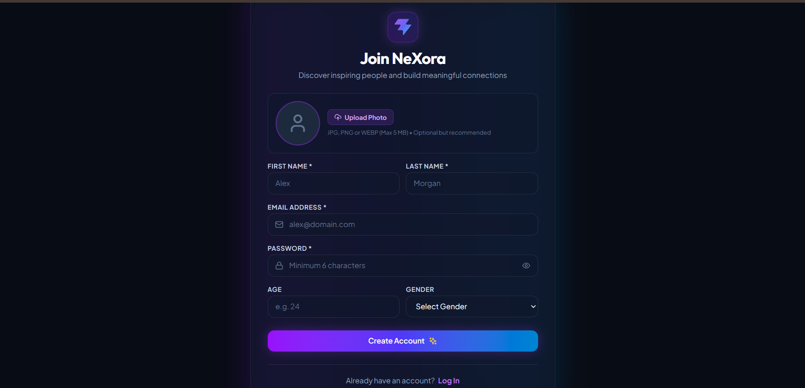
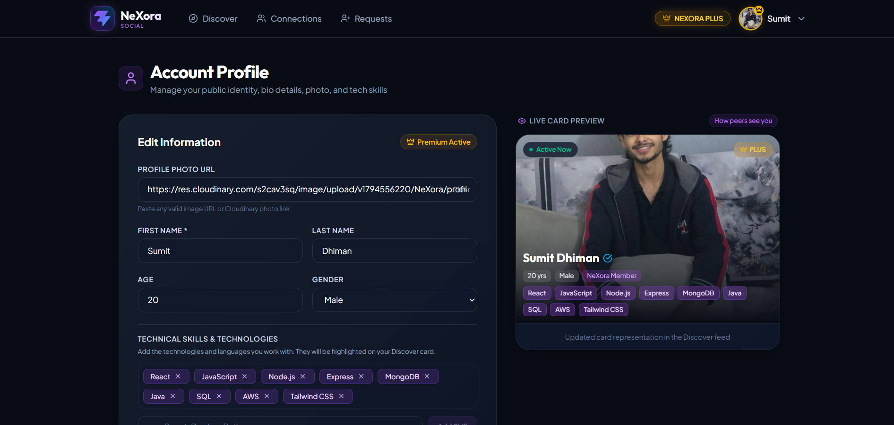
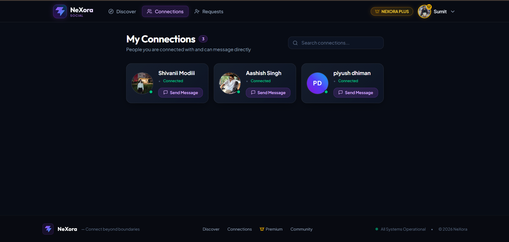

# NeXora — Frontend

<p align="center">

### Connect. Collaborate. Grow.

A developer networking platform built to help developers discover people, build professional connections, and grow their network.

</p>

---

## Screenshots

### Sign Up


### Developer Feed


### Developer Profile


### Connections


---

## Overview

NeXora is a developer networking platform that provides an environment for developers to create profiles, discover other developers, manage connection requests, and interact with the developer community.

This repository contains the frontend application of NeXora.

## Features

- **Authentication:** User login and signup.
- **Developer Profiles:** View and manage developer profiles.
- **Developer Discovery:** Explore developers through the feed.
- **Connection Management:** Send, receive, and manage connection requests.
- **State Management:** Centralized application state using Redux Toolkit.
- **API Integration:** Communicate with the backend using Axios.
- **Responsive Interface:** Modern UI built with Tailwind CSS and DaisyUI.
- **Real-time Integration:** Socket.IO client integration.

## Tech Stack

| Technology | Purpose |
|---|---|
| React 19 | Frontend library |
| Vite | Development and build tool |
| Redux Toolkit | State management |
| React Router 7 | Client-side routing |
| Axios | HTTP requests |
| Tailwind CSS 4 | Styling |
| DaisyUI 5 | UI components |
| Socket.IO Client | Real-time communication |

## Project Structure

```text
NeXora-frontend/
├── public/
├── src/
│   ├── components/
│   ├── pages/
│   ├── redux/
│   └── ...
├── screenshots/
├── index.html
├── package.json
├── vite.config.js
└── README.md
```

## Getting Started

Follow these steps to run the frontend locally.

### 1. Clone the repository

```bash
git clone https://github.com/143sumit05/NeXora-frontend.git
```

### 2. Navigate to the project directory

```bash
cd NeXora-frontend
```

### 3. Install dependencies

```bash
npm install
```

### 4. Configure environment variables

Configure the backend API URL using the environment variable expected by the frontend API configuration.

Check the existing API configuration in the source code for the exact variable name and required value.

### 5. Start the development server

```bash
npm run dev
```

The application will be available at the local URL displayed in your terminal.

### 6. Create a production build

```bash
npm run build
```

## Available Scripts

| Command | Description |
|---|---|
| `npm run dev` | Start development server |
| `npm run build` | Create production build |
| `npm run preview` | Preview production build |
| `npm run lint` | Run Oxlint |

## Related Repositories

NeXora uses separate repositories for its frontend and backend.

- **Frontend:** You are here.
- **Backend:** [NeXora Backend](https://github.com/143sumit05/NeXora-backend)
- **Main Project:** [NeXora Central Repository](https://github.com/143sumit05/NeXora)

## Future Scope

- Further improvements to the developer discovery experience.
- Enhanced real-time communication.
- Additional profile and networking features.
- UI and performance improvements.

## Author

**Sumit Dhiman**

[GitHub Profile](https://github.com/143sumit05)

---

<p align="center">
  Built with React, Redux Toolkit and Tailwind CSS.
</p>